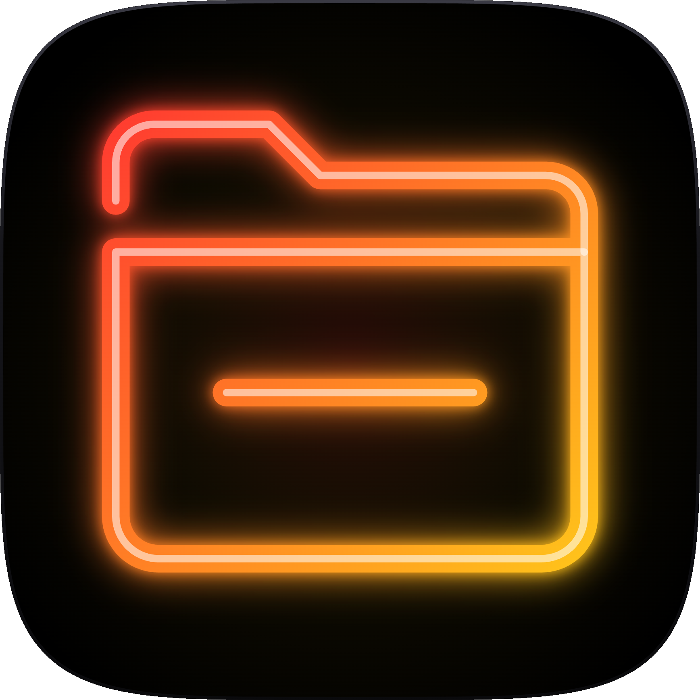

<p align="center">
  
</p>

<h1 align="center">Vanta Explorer</h1>

<p align="center">
  A file manager for Hyprland, in Rust, with true HDR previews.
</p>

---

- **HDR previews that are actually HDR**: AVIF, JXL, HEIC, PQ PNGs and video, shown as they were
  mastered instead of as washed-out gray. Everything else (SDR pictures, PDFs, documents, source
  code) gets a preview too.
- **Split panes and tabs**, a sidebar with drives, places and recent files, undo for moves,
  copies, renames and trashing, archives, drag and drop.
- **Follows your theme live**: colors, font and folder icons change with the desktop theme,
  without a restart and without losing your tabs.

The full feature list is in [crates/vantaexplorer/README.md](crates/vantaexplorer/README.md).

Vanta Explorer is one app from a larger set of desktop apps for Hyprland (Vanta) that is not
published yet. This repository holds Explorer and the shared code it is built from.

## Install (Arch Linux)

```bash
sudo pacman -S --needed base-devel git
git clone https://github.com/Waltherion/vanta-explorer ~/.local/src/vanta-explorer
cd ~/.local/src/vanta-explorer
makepkg -si
```

Update with `git pull && makepkg -si` in the same folder.

Wayland only. Made on Hyprland; other Wayland compositors should work but are not tested. HDR
needs a compositor with color management (Hyprland with `cm = "hdr"` on the monitor); on an
SDR screen it is an ordinary, SDR file manager.

**On Omarchy**: [docs/omarchy.md](docs/omarchy.md) sets it up to follow the Omarchy theme and
replace Nautilus on the usual keys.

**On plain Hyprland**: [docs/install.md](docs/install.md) has the window rules, the key, and
how to make it the file chooser other programs get.

## Configure

Settings live in `~/.config/vanta/`. Every key is in [docs/config.md](docs/config.md) (the
Explorer section, and `colors.jsonc` for colors and font). Changes are picked up within a second.

## Licence

GPL-3.0-or-later. See [LICENSE](LICENSE).
