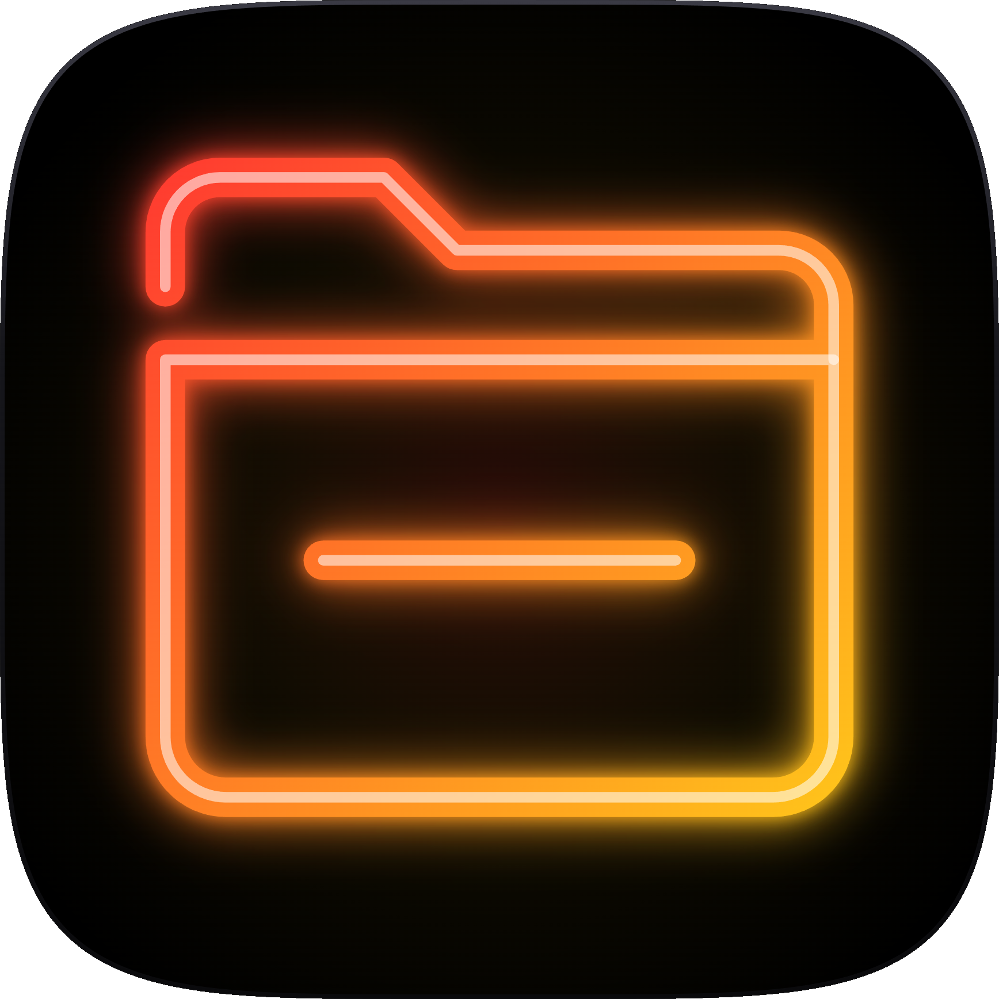

<p align="center">
  
</p>

<h1 align="center">Vanta Explorer</h1>

<p align="center">
  A file manager for Hyprland, in Rust, with true HDR previews.
</p>

---

## Why

Every file manager I tried shows HDR images and video as washed-out gray. They decode the
pixels and hand them to a toolkit that assumes 8-bit sRGB, so a PQ photo's highlights are
simply clipped away. If your wallpapers and footage are HDR, the previews are lying to you.

Vanta Explorer renders HDR content in a scRGB half-float swapchain, underneath the UI rather than
through it, so a Rec.2020 PQ image looks in the preview the way it looks in a real HDR viewer.

The second reason is theming. Vanta Explorer reloads its colors, font **and folder icons** live when
the desktop theme changes, without restarting and without losing your open tabs.

## What it does

### Previews that tell the truth

- **HDR stills, shown as HDR.** AVIF, JXL, HEIC/HEIF, 16-bit PNG with cICP, EXR, Radiance
  and more. Transfer function and primaries come from the file, and from the ICC profile
  when the container says nothing, which is what Lightroom exports do. A PQ highlight stays
  a highlight.
- **Video, with a seek slider.** Any container ffmpeg reads: mp4, mkv, webm, mov and the
  rest. Drag the slider under the preview to scrub through the file in 1% steps; each stop
  is decoded on demand, in the video's own color space.
- **Documents.** PDF pages with previous/next, ODF and OOXML thumbnails, SVG drawn on a
  checkerboard so both dark and light artwork read, and syntax-highlighted source for some
  fifty text formats.
- **A `file(1)` line under the image**, so you see what a file actually is rather than what
  its extension claims.
- **Folder sizes on demand**, and selection totals that include folder contents, computed
  in the background while the number you can see is marked as still counting.

### Rendering

The whole window is drawn through Vulkan into a half-float scRGB swapchain. HDR content is
rendered beneath the UI and composited by our own shaders, which is what lets it exceed
SDR white instead of being clipped by a toolkit. The UI's own brightness tracks Hyprland's
`sdrbrightness`, so the chrome sits level with the windows beside it on an HDR screen.
Present mode is MAILBOX, which is not a preference: FIFO on Wayland froze the window for
half a second at every idle-to-input transition. Video decoding itself is CPU-side.

### Thumbnails

- Grid view with **ctrl+scroll zoom**, real thumbnails for images, video first frames and
  documents, through a worker pool with a disk cache.
- **Folder previews**: folders show up to four of their own images laid on the folder icon.
- Decoding waits until you stop scrolling, so a flick through a folder starts no work at
  all, and finished thumbnails upload a few per frame rather than in one hitch.

### Panes and tabs

- **Unlimited splits** in a binary tree, tabs per pane, draggable dividers. Splitting across
  a pure row or column of panes escalates to the root, so the new pane spans the window.
- `Ctrl+T` / `Ctrl+W` for tabs, `Ctrl+PgUp` / `Ctrl+PgDn` between them, middle-click a folder
  to open it in a new tab, `Ctrl+Tab` or `F6` to cycle panes.
- A breadcrumb that **drops leading components** when the path is long, so the tail stays
  readable; click past it to edit the path as text.
- Columns that drop Modified, then Size, as a pane narrows, rather than painting over each
  other.

### Selecting and finding

- Type to filter the current folder; tick **Search subfolders** to walk the tree. Results
  carry their path relative to the folder, so two files with the same name stay distinct.
- Rubber-band selection from empty space, `Ctrl+A` for everything visible, and click-to-rename
  on an already selected name, held long enough that a double-click still opens the file.

### Working with files

- Copy, cut, paste, trash, rename and new folder, with progress, cancel and conflict prompts.
  Copied and cut files go on the system clipboard the way Nautilus and Dolphin put them
  there, so they paste between Explorer windows and to and from those file managers. Cut
  files are drawn faded until they are pasted.
- **Undo and redo**, `Ctrl+Z` / `Ctrl+Y`, for moves, copies, renames and trashing. Undo of a
  copy trashes the copies rather than deleting them, and an overwrite trashes the displaced
  file first, so undo can put it back. Permanent deletion is the one thing undo cannot
  reverse, so it is the one thing that asks first.
- **Drag and drop** between panes, between Explorer windows, and to and from other
  applications over `wl_data_device` (`text/uri-list` and plain text). A drag moves, Ctrl+drag
  copies, and a right-button drag asks which, also from one window to another. In the list,
  a drop on a folder's name goes into it and a drop in the Size or Modified column goes into
  the folder shown (the pane is outlined to say so); every folder in the path bar takes drops
  too. The note by the pointer names where the drop will land.
- **Archives**: extract here, extract to a folder, or compress a selection to tar.zst, tar.gz,
  zip or 7z, through libarchive. Extraction never overwrites, and undo trashes exactly what
  the archive added.
- **Copy path** as text (`Ctrl+Shift+P`), and **Open with**, including "always open with".
- **F1** lists every keyboard shortcut, and shows which commit this build is and when it was
  built.

### Sidebar

- **Mounted disks** with capacity bars and drive-type icons, and an **eject button on
  removable USB media only**: it requires the device to sit under a USB controller, be
  hot-pluggable, and be absent from `/etc/fstab`, so an internal drive never gets one.
- **Remote** for FUSE and cloud mounts, **Special Folders** from XDG, **Recent Files**
  opened through Vanta Explorer as a virtual folder, and your own **Places** sections.
- **Right-click to arrange it**: move a section or an entry up or down, rename or remove a
  section of your own, and remove any entry, special folders included. Right-click a folder in
  the file view and choose **Add to sidebar** to put it in Special Folders or one of your own
  sections, which is also how a removed special folder comes back.

### As a file chooser

- **The file chooser other programs get.** `vantaportal` answers xdg-desktop-portal, and the
  window a program's "open" or "save as" brings up is this file manager: the same places, theme,
  thumbnails and preview, in one pane, with a bar along the bottom.
- **The bar says what will be chosen**, as a whole path, and the button names the folder when it
  is a folder being chosen: a marked folder, or the one you are in when nothing is marked.
- **Saving** has a name field with the name up to its extension selected, takes the name of a
  file you mark, and asks before replacing one.
- It keeps its own window size and the folder each program last chose from, and never touches
  the file manager's session, recents or places. Setting it up is in `docs/install.md`.

### Theming

Colors, font **and folder icons** reload live when the config changes, without restarting
and without losing your tabs. Explorer comes with its own icons, the folders, file types and
drives of KDE's Breeze, and paints the folders in the theme's accent (or `color.folder`) as it
draws them. `"iconThemes": ["desktop"]` uses the desktop's icon theme instead.
Appearance lives in its own file so a theme switcher can overwrite it wholesale; your
sidebar and settings are kept apart and survive.

## Requirements

Wayland only, and it will refuse to start on X11. Developed against Hyprland, where it runs
without a titlebar; anything else implementing `xdg-shell` should work and gets its decorations,
though HDR needs a compositor that does color management. HDR has been verified on NVIDIA only.

Rust 2021, and these system libraries:

```
libavif libjxl libheif lcms2 ffmpeg poppler-glib shared-mime-info vulkan-icd-loader libarchive
```

`libavif` is linked from the system rather than built from source; see
`crates/vanta-hdr/build.rs` for why. Building also needs `glslc` (shaderc).

At run time it calls a few programs, and each feature quietly goes missing without its one:
`hyprctl` (HDR state and matching the desktop's SDR brightness), `fc-match` (fontconfig, the
theme font), `file` (the line under the preview), `xdg-open` and `xdg-mime` (xdg-utils),
`bsdtar` (archives; `libarchive-tools` on Debian and Ubuntu) and `udisksctl` (eject).

## Building

```
cargo build --release
```

The binary lands in `target/release/vantaexplorer`.

Three flags help when something looks wrong, and none of them open a window:

```
vantaexplorer --probe        # Vulkan surface formats and which one was chosen
vantaexplorer --doc-probe F  # how a document or SVG decodes, and how long it takes
vantaexplorer --apps-probe F # which applications are offered for a file
```

The chooser can be tried without the portal: `--choose` reads a request as JSON on standard input
and prints the answer (exit 0 chosen, 1 cancelled).

```
echo '{"mode":"save","title":"Save as","name":"notes.txt"}' | vantaexplorer --choose
```

The modes are `open`, `open-many`, `folder`, `save` and `save-many`.

## Configuration

Explorer reads the layered files every Vanta app shares (every key is in `docs/config.md`):

```
~/.config/vanta/colors.jsonc            the shared palette: colors and font
~/.config/vanta/explorer.jsonc          Explorer's own overrides; a theme links this
~/.config/vanta/explorer.local.jsonc    behavior: date format, terminal, icon themes
~/.config/vanta/explorer-sidebar.jsonc  your Places sections; never touched by a theme switch
```

The split is deliberate. Appearance is expected to be swapped wholesale by a theme switch, so
anything you would hate to lose lives in a different file.

Reloading works by polling the files rather than by watching them. That sounds lazy and is not:
theme scripts switch themes by moving a symlink, which kills an inotify watch silently, while a
look at the file through the link simply reports that it changed.

## Status

In daily use by its author since August 2026. Packaged for Arch Linux as a PKGBUILD.

## Licence

GPL-3.0. See [LICENSE](../../LICENSE). The icons in `assets/icon-theme` are from KDE's
[Breeze](https://invent.kde.org/frameworks/breeze-icons), LGPL-3.0-or-later.
